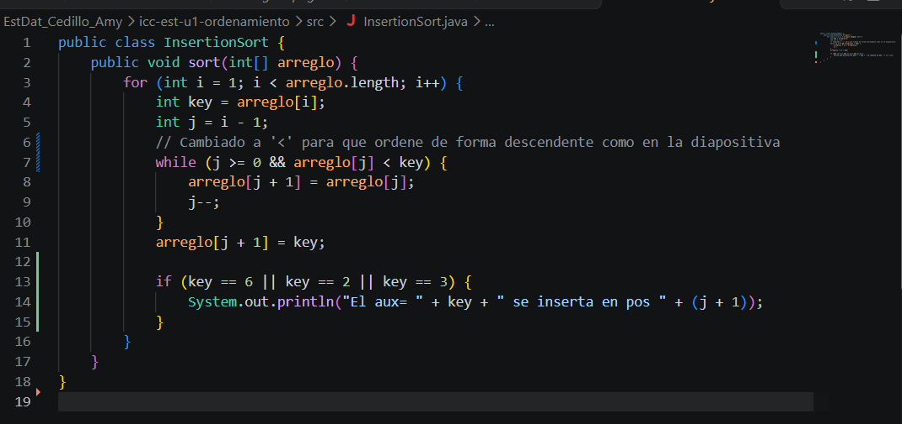
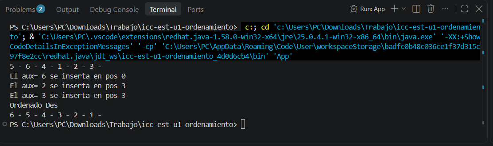

#PC 1.1.3

Método Insertion

Para las impresiones, simplemente creé la función (printArreglo) para mostrar los números separados por guiones en la consola, yo llamé a las variables en (App.java) antes y después de ordenar; además, dentro de (InsertionSort) agregué un (System.out.println) que avisa qué valor (aux) se va insertando y en qué posición. En cuanto al método de inserción, funciona como el ejemplo que nos dijo cuando ordenas cartas en la mano: este va tomando cada número uno por uno, lo compara con los anteriores hacia la izquierda y va corriendo los menores a la derecha para meter el valor en su lugar exacto de forma descendente.

Resultado

