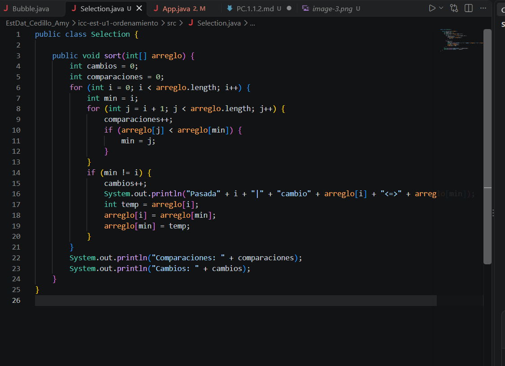
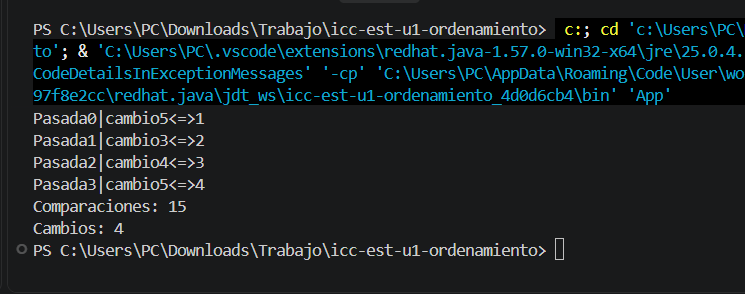

#PC 1.1.2

METODO SELECTION

Este código utiliza un bucle for externo para recorrer el arreglo y otro interno para buscar elementos menores, incrementando el contador comparaciones++ en cada iteración. Luego, mediante un condicional if evalúa si encontró un valor más pequeño (arreglo[j] < arreglo[min]) para actualizar el índice mínimo, y con un segundo if (min != i) verifica si debe realizar el intercambio físico de los datos usando una variable temporal (temp), lo cual incrementa el contador cambios++ y muestra el detalle de la pasada en la consola.

RESULTADO
